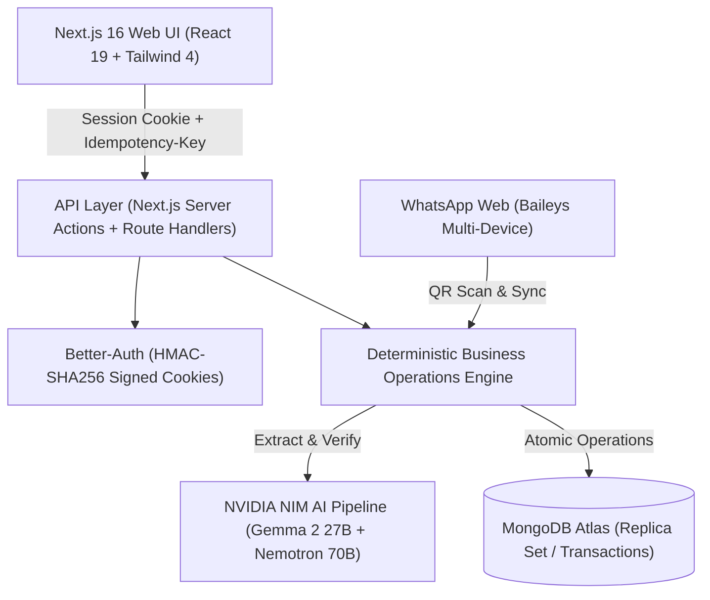
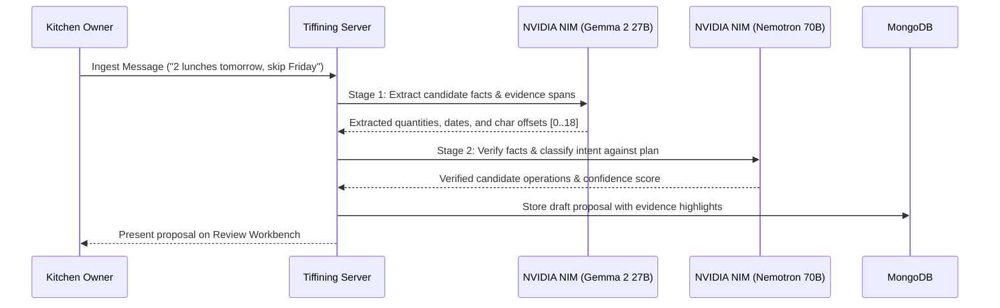

# Tiffining — Complete Feature Architecture & API Reference

> **Tiffining** is a high-reliability, full-stack meal management platform engineered specifically for independent home-food and tiffin businesses.
> It unifies messy customer messages (via WhatsApp/SMS), recurring weekday schedules, AI-assisted extraction and verification (powered by NVIDIA NIM), cryptographic proposal approvals, immutable daily packing sheets, delivery dispatch handovers, and monthly customer invoicing.

---

## Table of Contents

1. [Executive Summary & Product Boundary](#1-executive-summary--product-boundary)
2. [High-Level Architecture & Tech Stack](#2-high-level-architecture--tech-stack)
3. [Core Invariants & Architectural Principles](#3-core-invariants--architectural-principles)
4. [In-Depth Feature Modules](#4-in-depth-feature-modules)
   - [4.1 Authentication & Workspace Provisioning](#41-authentication--workspace-provisioning)
   - [4.2 Customer Management & Recurring Schedules](#42-customer-management--recurring-schedules)
   - [4.3 Message Intake & Source Ingestion](#43-message-intake--source-ingestion)
   - [4.4 NVIDIA NIM AI Extraction & Classification Pipeline](#44-nvidia-nim-ai-extraction--classification-pipeline)
   - [4.5 Proposal & Review Workbench](#45-proposal--review-workbench)
   - [4.6 Daily Packing Sheets & Kitchen Paper](#46-daily-packing-sheets--kitchen-paper)
   - [4.7 Dispatch & Delivery Handover](#47-dispatch--delivery-handover)
   - [4.8 Commerce, Pricing & Monthly Invoicing](#48-commerce-pricing--monthly-invoicing)
   - [4.9 WhatsApp Web Baileys Integration](#49-whatsapp-web-baileys-integration)
   - [4.10 Demand Forecasting & Historical Pipeline](#410-demand-forecasting--historical-pipeline)
   - [4.11 Privacy, GDPR & Right-to-be-Forgotten](#411-privacy-gdpr--right-to-be-forgotten)
   - [4.12 Idempotency & Audit Trail Ledger](#412-idempotency--audit-trail-ledger)
5. [Complete REST API Reference (All 53 Endpoints)](#5-complete-rest-api-reference)
   - [Health & System Status](#health--system-status)
   - [Seller & Workspace](#seller--workspace)
   - [Customer Operations](#customer-operations)
   - [Source Intake Operations](#source-intake-operations)
   - [AI & Intelligence Operations](#ai--intelligence-operations)
   - [Proposal & Review Operations](#proposal--review-operations)
   - [Days & Packing Sheet Operations](#days--packing-sheet-operations)
   - [Dispatch Operations](#dispatch-operations)
   - [Commerce & Invoicing Operations](#commerce--invoicing-operations)
   - [History & Forecasting Operations](#history--forecasting-operations)
   - [Privacy & Erasure Operations](#privacy--erasure-operations)
   - [Audit & Idempotency Receipts](#audit--idempotency-receipts)
   - [Webhooks](#webhooks)
6. [Database Schema & Collections Inventory](#6-database-schema--collections-inventory)
7. [System Error Code Encyclopedia](#7-system-error-code-encyclopedia)

---

## 1. Executive Summary & Product Boundary

### The Problem
Independent home tiffin services serve 15–100 regular customers who receive daily hot meals. These businesses face daily chaos:
- Customers communicate schedule changes through unstructured WhatsApp and SMS messages (*"no lunch today"*, *"send 2 tomorrow"*, *"travelling next week"*).
- Kitchen owners track baseline subscriptions and one-off changes in paper notebooks or messy spreadsheets.
- Missed cancellations lead to food waste; missed extras lead to disappointed customers.
- At the end of the month, reconstructing billing from chat histories is painful, error-prone, and causes payment disputes.

### The Tiffining Solution
Tiffining bridges informal messaging and rigorous accounting through a **propose-and-review** model:
1. **Models Propose**: Generative AI parses messages, detects intents, extracts dates, and drafts proposed changes.
2. **Humans Approve**: The kitchen owner reviews clear before-and-after calendar diffs and approves with one click.
3. **Code Calculates**: Deterministic, unit-tested math calculates totals, generates immutable kitchen sheets, routes deliveries, and builds invoices.

---

## 2. High-Level Architecture & Tech Stack



| Layer | Technology | Details |
|---|---|---|
| **Frontend Framework** | Next.js 16.3.8 (App Router) | Server Components, Server Actions, Client Components with dynamic streaming |
| **UI Library** | React 19.2.8 + Tailwind CSS 4 | Shadcn UI primitives, Base UI, Lucide icons, responsive drawer navigation |
| **Database** | MongoDB 7.7.0 (Atlas / Replica Set) | Official native driver, multi-document ACID transactions, TTL indexes |
| **Authentication** | Better-Auth 1.7.7 | MongoDB adapter, HMAC-signed session cookies, strict CSRF validation |
| **AI Inference** | NVIDIA NIM Cloud API | `google/gemma-2-27b-it` (Extraction) + `nvidia/llama-3.1-nemotron-70b-instruct` (JEV) |
| **Messaging** | `@whiskeysockets/baileys` | Native WhatsApp Web multi-device socket protocol without heavy browser overhead |
| **Data Validation** | Zod 4.6.5 | Strict schema validation on every single API request, response, and database document |
| **Time & Dates** | `@js-temporal/polyfill` | Timezone-aware date calculations anchored to seller business timezone (`Asia/Kolkata`) |

---

## 3. Core Invariants & Architectural Principles

1. **AI Never Writes to Production**: NVIDIA NIM models only propose draft actions. High model confidence never bypasses human review.
2. **Deterministic Math**: Meal quantities, order totals, price calculations, and invoice summaries are calculated by pure TypeScript functions, never guessed by LLMs.
3. **Exceptions Do Not Overwrite Baselines**: A one-off cancellation or extra lunch creates a `dailyOverrides` record for that specific date. It never modifies the customer's permanent recurring plan.
4. **Cryptographic Preview Integrity (`previewHash`)**: When an owner approves a proposal, the server verifies that the state hasn't changed since the owner viewed the preview. If a concurrent change occurred, approval is rejected.
5. **Immutable Kitchen Sheets**: Finalized packing sheets are saved as immutable revisions (`REV-1`, `REV-2`). Late changes create new revision numbers rather than silently mutating past sheets.
6. **Mandatory Idempotency**: All mutating operations require an `Idempotency-Key` header. Duplicate network requests return identical cached receipts without executing twice.

---

## 4. In-Depth Feature Modules

### 4.1 Authentication & Workspace Provisioning
- **Better-Auth Integration**: Implements email and Google OAuth authentication backed by MongoDB collections (`user`, `session`, `account`, `verification`).
- **Session Cookie Architecture**: Uses cryptographically signed cookies (`better-auth.session_token=<token>.<hmac-sha256>`) to prevent cookie forgery and session hijacking.
- **Single-Tenant Workspace Isolation**: Each authenticated user binds to an active `seller` record. Every database query filters by `sellerId`.
- **Configurable Settings**:
  - `timezone`: Default `Asia/Kolkata`. Dates are computed relative to local kitchen time, not UTC server time.
  - `weekdays`: Days the kitchen operates (e.g. `[1, 2, 3, 4, 5, 6]` for Monday through Saturday).
  - `quantityCap`: Maximum meals the kitchen can cook in a single lunch service.
  - `customerCap`: Maximum active customer accounts.
  - `planningTime` and `cutoffTime`: Order cutoff boundaries.

---

### 4.2 Customer Management & Recurring Schedules
- **Customer Profiles**: Stores customer alias, contact phone, delivery building/flat, dietary restrictions, and status (`active` / `paused` / `archived`).
- **Recurring Plans (`plans` collection)**:
  - Weekly schedule array of 7 integers (`quantities: [1, 1, 1, 1, 1, 0, 0]`).
  - Effective date boundaries: `startDate` (inclusive) and optional `endDate`.
- **Dynamic 31-Day Projection**:
  - Endpoint `GET /api/v1/customers/{customerId}/schedule` projects the upcoming month by overlaying recurring plans with approved daily overrides.

---

### 4.3 Message Intake & Source Ingestion
- **Multi-Channel Ingestion**: Supports pasting raw text from SMS/WhatsApp, importing bulk messages, and real-time webhook ingestion.
- **Source Record Lifecycle**:
  - Generates SHA-256 fingerprint of message text and customer association.
  - Detects duplicate messages within 24 hours to prevent double-counting.
  - Tracks lifecycle: `pending` → `analyzed` → `reviewed` → `archived`.
- **Timezone Resolution**: Captures the exact UTC instant the customer sent the message (`sentAt`) and resolves relative phrases like *"tomorrow"* against the kitchen's local business calendar.

---

### 4.4 NVIDIA NIM AI Extraction & Classification Pipeline

Tiffining employs an advanced, decoupled two-stage LLM pipeline hosted on NVIDIA NIM:



1. **Stage 1 — Fact & Span Extraction (`google/gemma-2-27b-it`)**:
   - Parses colloquial customer language (English, Hinglish).
   - Extracts date tokens, quantities, and character spans (`evidenceSpans: [{ start: 0, end: 18 }]`).
2. **Stage 2 — TypeSafe JEV Verification (`nvidia/llama-3.1-nemotron-70b-instruct`)**:
   - Evaluates whether the message replaces an existing instruction.
   - Categorizes intent: `set_daily_quantity`, `replace_recurring_plan`, `skip_service`.
   - Flags missing or contradictory information.
3. **Token Quota & Guardrails**:
   - Hard daily input token limit (`AI_DAILY_INPUT_TOKEN_LIMIT`).
   - Per-request stage timeouts (`AI_STAGE_TIMEOUT_MS = 20000ms`).
   - Full audit trail stored in `aiRuns` collection with model provenance, prompt versions, and token usage.

---

### 4.5 Proposal & Review Workbench
- **Before-and-After Calendar Preview**: Visualizes exactly which dates are affected, the prior quantity, and the proposed new quantity.
- **Cryptographic Preview Hash**:
  - Hashes the proposal ID, draft revision, affected dates, and expected state revision into a 64-character SHA-256 hash.
  - Guarantees that what the owner saw on screen is exactly what gets committed.
- **Late-Change Safety Guard**:
  - If a proposal affects a date that already has a finalized packing sheet, the UI requires explicit acknowledgement (`acknowledgeLateChange: true`).
- **Actions**:
  - `Approve`: Commits overrides to `dailyOverrides` and updates state revision.
  - `Reject`: Closes proposal with recorded reason.
  - `Defer`: Pushes proposal to a later date for re-evaluation.

---

### 4.6 Daily Packing Sheets & Kitchen Paper
- **Day Aggregation Engine**:
  - Retrieves active customer plans for `serviceDate`.
  - Applies approved daily overrides for that date.
  - Derives total meals required and individual packing allocations.
- **Immutable Sheet Finalization**:
  - Generates snapshot stored in `sheets` collection with UUID and incremental revision number (`REV-1`).
  - Calculates building-wise breakdown for delivery prep.
- **Ink-Friendly Kitchen Paper**:
  - Clean HTML/CSS layout optimized for thermal printers or black-and-white A4 clipboards.
- **CSV Export**:
  - RFC 4180 compliant CSV generation with columns: `Customer Alias`, `Address`, `Quantity`, `Special Instructions`.

---

### 4.7 Dispatch & Delivery Handover
- **Automatic Route Clustering**: Groups deliveries by apartment building or locality.
- **Driver Checklist**: Provides drivers with a mobile checklist showing apartment numbers, customer phone numbers, and delivery confirmation buttons.
- **Printable Dispatch Roster**: Single-page delivery summary sheet for delivery personnel.

---

### 4.8 Commerce, Pricing & Monthly Invoicing
- **Commerce Settings**:
  - Standard meal rate (e.g. ₹120).
  - Weekend premium rate.
  - Packaging / delivery monthly surcharge.
- **Automated Invoice Engine**:
  - Aggregates actual meals delivered within a billing cycle (`periodStart` to `periodEnd`).
  - Itemizes regular meals, extra meals, and skips.
  - Generates unique invoice numbers (e.g. `INV-2026-10-001`).
- **WhatsApp Share Generator**:
  - Creates a pre-filled `https://wa.me/{phone}?text=...` link containing the complete itemized bill and UPI payment link.

---

### 4.9 WhatsApp Web Baileys Integration
- **Direct Multi-Device Pairing**: Connects to the WhatsApp Web protocol via `@whiskeysockets/baileys`.
- **QR Code Authentication**: Generates dynamic QR codes in the dashboard for instant phone camera pairing.
- **Contact Sync**: Reads kitchen contact threads directly into the intake drawer.
- **Zero Heavy Browser Headless Overhead**: Runs purely via WebSocket protocol buffers, consuming <30MB RAM.

---

### 4.10 Demand Forecasting & Historical Pipeline
- **Planning Snapshots**: Captures daily snapshots of orders, weather, and day-of-week patterns.
- **TabPFN Integration**: Connects to TabPFN prior-fitted neural networks for tabular demand prediction.
- **Trend Evaluation**: Computes moving average baselines to help the kitchen procure vegetables, groceries, and tiffin boxes 3 days in advance.

---

### 4.11 Privacy, GDPR & Right-to-be-Forgotten
- **Full Data Portability (`GET /api/v1/privacy/export`)**:
  - Generates a machine-readable JSON archive of all customer profiles, order history, audit receipts, and finalized sheets.
- **Targeted Source Erasure (`POST /api/v1/privacy/source-erasures`)**:
  - Permanently purges raw customer text messages after extraction and approval, eliminating storage of customer personal messages.
- **Full Account Deletion (`POST /api/v1/privacy/seller-erasure`)**:
  - Cascades complete deletion across all 26 collections associated with the seller.
- **Dry-Run Retention**: Simulates data pruning for compliance audits without dropping records.

---

### 4.12 Idempotency & Audit Trail Ledger
- **Idempotency Architecture**:
  - Every mutating request must provide a unique UUID in `Idempotency-Key`.
  - The server stores completed operation receipts in the `receipts` collection.
  - If a network timeout causes a retry, the server recognizes the key and returns the identical receipt without duplicate execution.
- **Audit Ledger**:
  - Every approved meal change records:
    - User ID of the approver.
    - Exact UTC timestamp.
    - State revision number before and after.
    - Linked source message ID and proposal ID.

---

## 5. Complete REST API Reference

Every endpoint in Tiffining returns a standardized JSON envelope:
- **Success**: `{ "ok": true, "data": <Payload>, "meta": { "requestId": "<UUID>", "stateRevision": <int> } }`
- **Failure**: `{ "ok": false, "error": { "code": "<CODE>", "message": "<Message>", "retryable": <bool> }, "meta": { "requestId": "<UUID>" } }`

---

### Health & System Status

#### `GET /api/health/live`
- **Description**: Basic liveness probe for container orchestrators.
- **Auth Required**: No
- **Response**: `200 OK` `{ "ok": true }`

#### `GET /api/health/ready`
- **Description**: Readiness probe verifying MongoDB connectivity and active replica set status.
- **Auth Required**: No
- **Response**: `200 OK` `{ "ok": true }` / `503 Service Unavailable`

---

### Seller & Workspace

#### `GET /api/v1/me`
- **Description**: Returns the active seller profile, kitchen settings, current state revision, and feature capabilities.
- **Auth Required**: Yes (Session Cookie)
- **Response**: `200 OK`
```json
{
  "seller": {
    "_id": "b18b5f6d-45a1-4172-bc5e-497b767e15ba",
    "ownerUserId": "demo-owner",
    "settings": {
      "timezone": "Asia/Kolkata",
      "weekdays": [1, 2, 3, 4, 5, 6],
      "quantityCap": 100,
      "customerCap": 100,
      "planningTime": "09:00",
      "cutoffTime": "10:00"
    },
    "stateRevision": 9,
    "status": "active"
  },
  "stateRevision": 9,
  "capabilities": {
    "manualOrders": true,
    "textImport": true,
    "ai": true
  }
}
```

#### `GET /api/v1/settings`
- **Description**: Retrieves current kitchen operational settings.
- **Auth Required**: Yes

#### `PATCH /api/v1/settings`
- **Description**: Updates kitchen operating parameters (timezone, weekdays, caps).
- **Auth Required**: Yes (Mutation)
- **Header**: `Idempotency-Key: <UUID>`
- **Request Body**:
```json
{
  "settings": {
    "timezone": "Asia/Kolkata",
    "weekdays": [1, 2, 3, 4, 5],
    "quantityCap": 120,
    "customerCap": 80
  },
  "expectedStateRevision": 9
}
```

#### `GET /api/v1/capabilities`
- **Description**: Returns dynamic feature flags and AI integration status.
- **Auth Required**: Yes

---

### Customer Operations

#### `GET /api/v1/customers`
- **Description**: Returns paginated list of customers for the active seller.
- **Auth Required**: Yes
- **Query Parameters**: `limit` (default 50), `cursor` (optional pagination token)

#### `POST /api/v1/customers`
- **Description**: Creates a new customer profile.
- **Auth Required**: Yes (Mutation)
- **Header**: `Idempotency-Key: <UUID>`
- **Request Body**:
```json
{
  "alias": "Rohan Gupta",
  "phone": "+919876543210",
  "deliveryAddress": "Flat 402, Green Valley Apartments",
  "notes": "Vegetarian, no onion",
  "expectedStateRevision": 9
}
```

#### `GET /api/v1/customers/{customerId}`
- **Description**: Retrieves customer profile by ID.
- **Auth Required**: Yes

#### `PATCH /api/v1/customers/{customerId}`
- **Description**: Updates customer profile details or status.
- **Auth Required**: Yes (Mutation)
- **Header**: `Idempotency-Key: <UUID>`

#### `GET /api/v1/customers/{customerId}/schedule`
- **Description**: Returns 31-day projected meal delivery schedule for the customer.
- **Auth Required**: Yes
- **Query Parameters**: `fromDate` (YYYY-MM-DD), `toDate` (YYYY-MM-DD)

---

### Source Intake Operations

#### `GET /api/v1/sources`
- **Description**: Lists ingested customer messages with review status.
- **Auth Required**: Yes
- **Query Parameters**: `status` (`pending` | `reviewed` | `archived`), `customerId` (optional)

#### `POST /api/v1/sources`
- **Description**: Ingests one or more raw customer text messages.
- **Auth Required**: Yes (Mutation)
- **Header**: `Idempotency-Key: <UUID>`
- **Request Body**:
```json
{
  "sources": [
    {
      "customerId": "cust-uuid-1",
      "text": "Please send 2 meals tomorrow and cancel Friday",
      "sentAt": "2026-10-24T08:30:00Z"
    }
  ],
  "expectedStateRevision": 9
}
```

#### `GET /api/v1/sources/{sourceId}`
- **Description**: Retrieves a single raw source message and all linked candidate proposals.
- **Auth Required**: Yes

#### `PATCH /api/v1/sources/{sourceId}`
- **Description**: Corrects source message metadata (e.g. reassigning to correct customer).
- **Auth Required**: Yes (Mutation)
- **Header**: `Idempotency-Key: <UUID>`

#### `POST /api/v1/sources/{sourceId}/disposition`
- **Description**: Closes or dismisses an ingested message.
- **Auth Required**: Yes (Mutation)
- **Header**: `Idempotency-Key: <UUID>`
- **Request Body**:
```json
{
  "action": "dismiss",
  "reason": "Customer called back to cancel request",
  "expectedSourceRevision": 0
}
```

---

### AI & Intelligence Operations

#### `POST /api/v1/sources/{sourceId}/analyses`
- **Description**: Triggers asynchronous NVIDIA NIM AI extraction and verification on an ingested message.
- **Auth Required**: Yes (Mutation)
- **Header**: `Idempotency-Key: <UUID>`

#### `GET /api/v1/analyses/{runId}`
- **Description**: Retrieves status and output of an AI analysis job.
- **Auth Required**: Yes
- **Response**: Returns run state (`running`, `completed`, `failed`), extracted operations, confidence scores, and token usage.

#### `GET /api/v1/analyses/by-key/{requestKey}`
- **Description**: Idempotent lookup of an AI analysis run by its original client request key.
- **Auth Required**: Yes

#### `POST /api/v1/analyses/{runId}/retry`
- **Description**: Retries a failed AI extraction job.
- **Auth Required**: Yes (Mutation)
- **Header**: `Idempotency-Key: <UUID>`

---

### Proposal & Review Operations

#### `GET /api/v1/proposals`
- **Description**: Lists candidate order change proposals pending review.
- **Auth Required**: Yes
- **Query Parameters**: `status` (`draft` | `approved` | `rejected`), `serviceDate` (optional)

#### `POST /api/v1/proposals`
- **Description**: Manually creates a draft order proposal (e.g. from a phone call).
- **Auth Required**: Yes (Mutation)
- **Header**: `Idempotency-Key: <UUID>`
- **Request Body**:
```json
{
  "sourceId": null,
  "manualReason": "Customer phoned in verbal request",
  "operations": [
    {
      "type": "set_daily_quantity",
      "customerId": "cust-uuid-1",
      "serviceDate": "2026-10-25",
      "quantity": 2
    }
  ],
  "missingFields": [],
  "evidenceSpans": [],
  "expectedStateRevision": 9
}
```

#### `GET /api/v1/proposals/{proposalId}`
- **Description**: Retrieves full details of a proposal, including candidate operations and evidence spans.
- **Auth Required**: Yes

#### `PATCH /api/v1/proposals/{proposalId}`
- **Description**: Edits a draft proposal before approval.
- **Auth Required**: Yes (Mutation)
- **Header**: `Idempotency-Key: <UUID>`

#### `POST /api/v1/proposals/{proposalId}/preview`
- **Description**: Simulates the proposal against the calendar, generating before-and-after counts and a cryptographic `previewHash`.
- **Auth Required**: Yes
- **Request Body**: `{ "expectedDraftRevision": 0 }`
- **Response**:
```json
{
  "proposalId": "prop-uuid-1",
  "affectedDates": ["2026-10-25"],
  "effects": [
    { "customerId": "cust-uuid-1", "serviceDate": "2026-10-25", "before": 1, "after": 2 }
  ],
  "totals": [
    { "serviceDate": "2026-10-25", "before": 24, "after": 25 }
  ],
  "previewHash": "a1b2c3d4e5f67890123456789abcdef0123456789abcdef0123456789abcdef0",
  "requiredAcknowledgements": []
}
```

#### `POST /api/v1/proposals/{proposalId}/approve`
- **Description**: Atomically approves a proposal and commits daily overrides.
- **Auth Required**: Yes (Mutation)
- **Header**: `Idempotency-Key: <UUID>`
- **Request Body**:
```json
{
  "expectedDraftRevision": 0,
  "expectedSourceRevision": 0,
  "previewHash": "a1b2c3d4e5f67890123456789abcdef0123456789abcdef0123456789abcdef0",
  "supersedesApprovalIds": [],
  "acknowledgeLateChange": false,
  "expectedStateRevision": 9
}
```

#### `POST /api/v1/proposals/{proposalId}/disposition`
- **Description**: Rejects or defers a proposal.
- **Auth Required**: Yes (Mutation)
- **Header**: `Idempotency-Key: <UUID>`

---

### Days & Packing Sheet Operations

#### `GET /api/v1/days/{serviceDate}`
- **Description**: Returns the real-time aggregated meal count for `serviceDate`, combining recurring plans and approved overrides.
- **Auth Required**: Yes
- **Response**:
```json
{
  "serviceDate": "2026-10-25",
  "total": 25,
  "pendingCount": 0,
  "latestSheetId": "sheet-uuid-1",
  "rows": [
    { "customerId": "cust-uuid-1", "alias": "Aarav Sharma", "baseline": 1, "quantity": 2 }
  ]
}
```

#### `GET /api/v1/days/{serviceDate}/sheets`
- **Description**: Lists all historical packing sheet revisions generated for `serviceDate`.
- **Auth Required**: Yes

#### `POST /api/v1/days/{serviceDate}/sheets`
- **Description**: Finalizes an immutable packing sheet for the kitchen clipboard.
- **Auth Required**: Yes (Mutation)
- **Header**: `Idempotency-Key: <UUID>`
- **Request Body**:
```json
{
  "serviceDate": "2026-10-25",
  "expectedPriorSheetId": null,
  "acknowledgeLateChange": true,
  "expectedStateRevision": 9
}
```

#### `GET /api/v1/sheets/{sheetId}`
- **Description**: Retrieves full data of an immutable finalized packing sheet.
- **Auth Required**: Yes

#### `GET /api/v1/sheets/{sheetId}/export`
- **Description**: Exports the packing sheet as a downloadable CSV.
- **Auth Required**: Yes
- **Query Parameters**: `format=csv`

---

### Dispatch Operations

#### `GET /api/v1/days/{serviceDate}/dispatch`
- **Description**: Returns building-by-building delivery clusters, room numbers, customer notes, and driver handover checklists.
- **Auth Required**: Yes

---

### Commerce & Invoicing Operations

#### `GET /api/v1/commerce/setup`
- **Description**: Retrieves commercial pricing settings and billing defaults.
- **Auth Required**: Yes

#### `PATCH /api/v1/commerce/settings`
- **Description**: Updates meal pricing, tax, and packaging fees.
- **Auth Required**: Yes (Mutation)
- **Header**: `Idempotency-Key: <UUID>`

#### `PATCH /api/v1/customers/{customerId}/commerce`
- **Description**: Sets custom billing terms or rates for a specific customer.
- **Auth Required**: Yes (Mutation)
- **Header**: `Idempotency-Key: <UUID>`

#### `POST /api/v1/invoices/preview`
- **Description**: Calculates itemized bill for a customer over a date range without saving an invoice.
- **Auth Required**: Yes
- **Request Body**:
```json
{
  "customerId": "cust-uuid-1",
  "periodStart": "2026-10-01",
  "periodEnd": "2026-10-31"
}
```

#### `POST /api/v1/invoices`
- **Description**: Issues an immutable, numbered monthly invoice.
- **Auth Required**: Yes (Mutation)
- **Header**: `Idempotency-Key: <UUID>`

#### `GET /api/v1/invoices`
- **Description**: Lists issued invoices with payment statuses.
- **Auth Required**: Yes

#### `GET /api/v1/invoices/{invoiceId}`
- **Description**: Retrieves single invoice details and line items.
- **Auth Required**: Yes

---

### History & Forecasting Operations

#### `POST /api/v1/history/imports`
- **Description**: Stages historical delivery records from CSV or legacy logs.
- **Auth Required**: Yes (Mutation)

#### `GET /api/v1/history/imports/{importId}`
- **Description**: Inspects staged historical records and validation errors.
- **Auth Required**: Yes

#### `POST /api/v1/history/imports/{importId}/commit`
- **Description**: Commits validated historical records into the analytics store.
- **Auth Required**: Yes (Mutation)

#### `GET /api/v1/history`
- **Description**: Lists historical meal performance data.
- **Auth Required**: Yes

#### `POST /api/v1/days/{serviceDate}/planning-snapshots`
- **Description**: Captures a snapshot of orders, lead-times, and prep schedules for forecasting.
- **Auth Required**: Yes (Mutation)

#### `POST /api/v1/days/{serviceDate}/outcomes`
- **Description**: Records actual meals consumed and leftover counts for model calibration.
- **Auth Required**: Yes (Mutation)

#### `POST /api/v1/days/{serviceDate}/forecasts`
- **Description**: Requests an ML demand forecast for an upcoming date.
- **Auth Required**: Yes (Mutation)

#### `GET /api/v1/days/{serviceDate}/forecasts`
- **Description**: Lists past forecasts and accuracy scores for `serviceDate`.
- **Auth Required**: Yes

#### `GET /api/v1/forecasts/{forecastId}`
- **Description**: Retrieves forecast details, confidence intervals, and TabPFN weights.
- **Auth Required**: Yes

#### `GET /api/v1/forecasts/by-key/{requestKey}`
- **Description**: Retrieves forecast by client idempotency key.
- **Auth Required**: Yes

---

### Privacy & Erasure Operations

#### `GET /api/v1/privacy/export`
- **Description**: Exports a complete machine-readable archive (JSON) of all customer, order, sheet, and audit records.
- **Auth Required**: Yes

#### `POST /api/v1/privacy/source-erasures`
- **Description**: Purges raw source message text for customer privacy compliance.
- **Auth Required**: Yes (Mutation)
- **Header**: `Idempotency-Key: <UUID>`

#### `POST /api/v1/privacy/seller-erasure`
- **Description**: Permanently wipes the entire seller workspace and all associated customer data.
- **Auth Required**: Yes (Mutation)
- **Header**: `Idempotency-Key: <UUID>`

#### `GET /api/v1/privacy/operations/{operationId}`
- **Description**: Tracks the execution progress of an ongoing data erasure operation.
- **Auth Required**: Yes

---

### Audit & Idempotency Receipts

#### `GET /api/v1/operations/{idempotencyKey}`
- **Description**: Retrieves the audit receipt for any mutation by its `Idempotency-Key`.
- **Auth Required**: Yes

---

### Webhooks

#### `POST /api/webhooks/whatsapp`
- **Description**: Ingests incoming WhatsApp messages from external gateways.
- **Auth Required**: Webhook signature verification

---

## 6. Database Schema & Collections Inventory

Tiffining manages 26 collections in MongoDB:

| Collection | Primary Indexes | Description |
|---|---|---|
| `sellers` | `ownerUserId (unique)`, `status` | Kitchen identity, operating parameters, and state revisions. |
| `user` | `id (unique)`, `email` | Better-Auth verified user records. |
| `session` | `token (unique)`, `userId` | Active authenticated user sessions. |
| `customers` | `sellerId, alias (unique)`, `status` | Customer identities, delivery addresses, dietary notes. |
| `plans` | `sellerId, customerId, startDate` | Recurring weekly baseline delivery schedules. |
| `dailyOverrides` | `sellerId, customerId, serviceDate (unique)` | Specific date exceptions (+1 meal, skip, or extra). |
| `sources` | `sellerId, hash`, `createdAt` | Ingested raw messages with SHA duplicate fingerprinting. |
| `proposals` | `sellerId, status`, `serviceDate` | AI and manually generated change proposals. |
| `sheets` | `sellerId, serviceDate, revisionNumber` | Immutable finalized packing sheets with UUIDs. |
| `receipts` | `sellerId, idempotencyKey (unique)` | Audit receipts guaranteeing idempotent operation replay. |
| `invoices` | `sellerId, invoiceNumber (unique)`, `customerId` | Issued monthly billing statements. |
| `commerceSettings`| `sellerId (unique)` | Per-meal pricing rules and packaging surcharges. |
| `customerCommerce`| `sellerId, customerId (unique)` | Custom pricing agreements for individual customers. |
| `aiRuns` | `sellerId, runId (unique)`, `createdAt` | NVIDIA NIM execution manifests and token logs. |
| `aiAdmissions` | `sellerId, date` | Daily token quota and rate-limiting buckets. |
| `planningSnapshots`| `sellerId, serviceDate` | Operational snapshots for machine learning training. |
| `outcomes` | `sellerId, serviceDate` | Ground-truth meal counts for forecast evaluation. |
| `forecastRuns` | `sellerId, runId (unique)` | Predictive demand runs generated by TabPFN. |
| `privacyOperations`| `sellerId, operationId (unique)` | Async tracking for GDPR data deletions. |
| `historyImports` | `sellerId, importId (unique)` | Staged legacy CSV imports. |

---

## 7. System Error Code Encyclopedia

All API errors return consistent JSON structures with clear remediation paths:

| Error Code | HTTP Status | Meaning | Recommended Action |
|---|---|---|---|
| `UNAUTHENTICATED` | 401 | Missing or invalid session cookie. | Authenticate or run `pnpm session:generate`. |
| `FORBIDDEN` | 403 | User does not have an active seller workspace binding. | Run `pnpm owner:provision`. |
| `CONCURRENCY_CONFLICT` | 409 | `expectedStateRevision` is out of date. | Re-fetch `/api/v1/me` and retry with current revision. |
| `IDEMPOTENCY_MISMATCH` | 422 | Same idempotency key used with different payload. | Generate a fresh UUID for new operations. |
| `DUPLICATE_SOURCE` | 409 | Exact same text ingested within 24 hours. | Verify if customer repeated message or acknowledge duplicate. |
| `PREVIEW_MISMATCH` | 409 | State changed between preview and approval. | Request fresh preview to obtain updated `previewHash`. |
| `LATE_CHANGE_REQUIRED` | 409 | Proposal affects an already-finalized sheet. | Pass `acknowledgeLateChange: true` to confirm revision. |
| `RATE_LIMITED` | 429 | Exceeded request limits. | Back off and retry with exponential jitter. |
| `AI_TIMEOUT` | 504 | NVIDIA NIM model took longer than 20 seconds. | Retry or enter manual proposal. |
| `INDEXES_REQUIRED` | 503 | Database schema indexes not built. | Run `pnpm db:init` on the server. |
